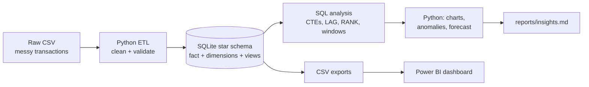
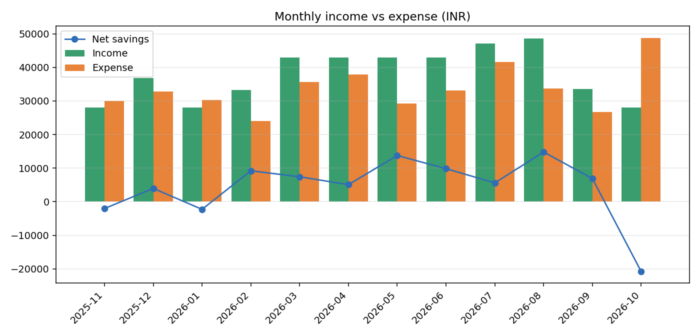
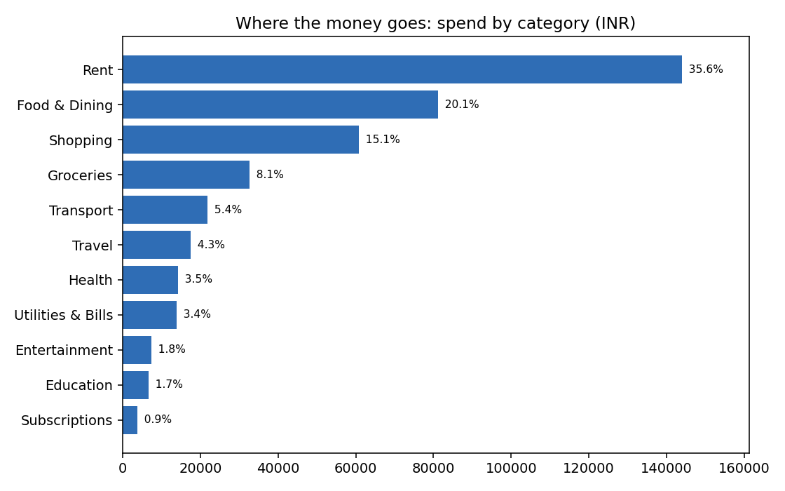
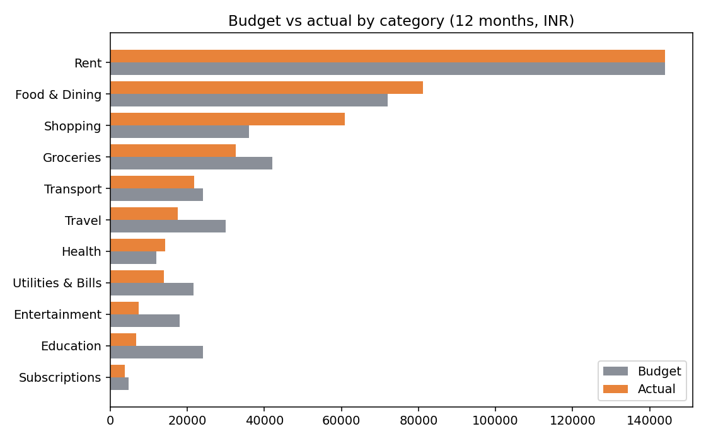
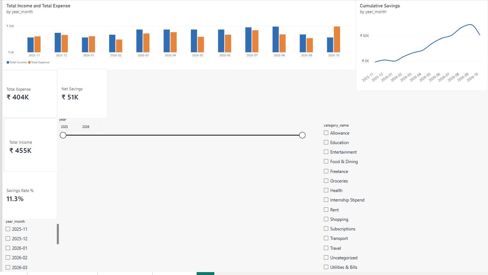
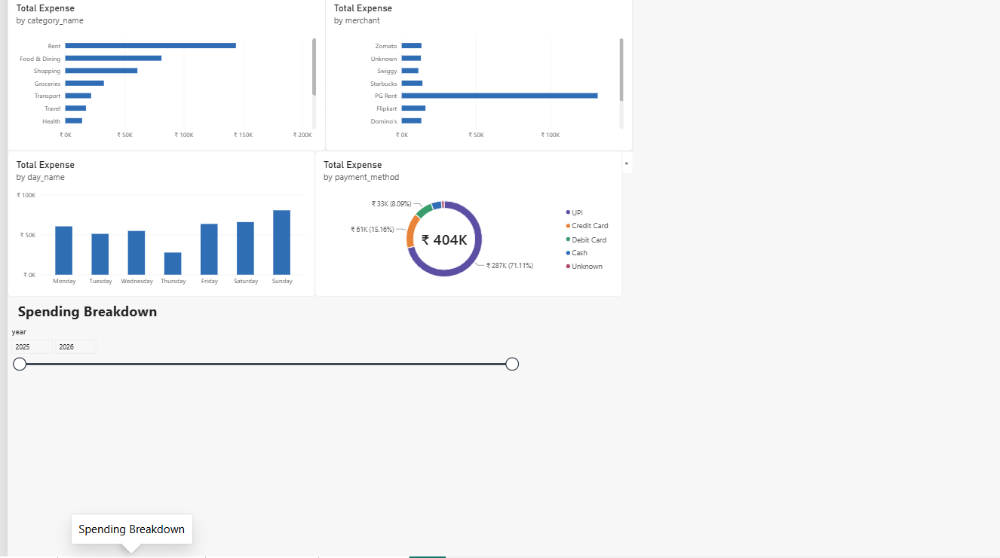
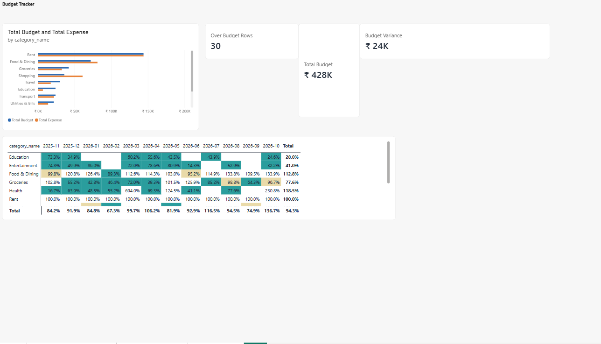
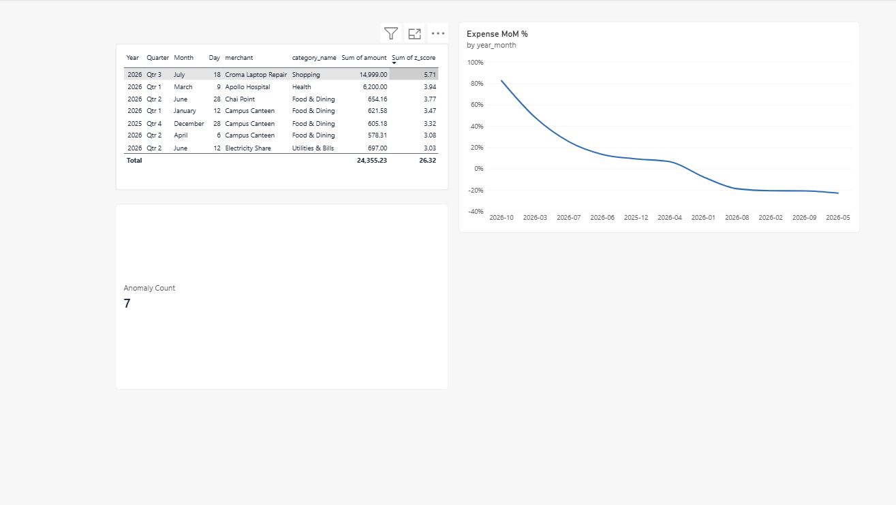

# Personal Expense Analytics (SQL + Python + Power BI)

[](https://github.com/Yashi-tech-png/expense-analytics/actions)

An end-to-end analytics project: raw, messy bank-style transactions go through a **Python ETL**,
land in a **star-schema SQL database**, are analysed with **window-function SQL**, and are then served
to a **Power BI dashboard**. One command runs everything, and automated tests prove the numbers reconcile.

## What problem does it solve?
Most people cannot answer: *Where does my money go? Am I within budget? Which months are risky?*
This project answers those questions from raw transaction data and flags unusual spending automatically.

## Architecture



## Tech and skills demonstrated
| Area | What is used |
|---|---|
| SQL | Star schema, constraints, indexes, views, CTEs, `LAG`, `RANK`, `SUM() OVER`, conditional aggregation |
| Python | pandas ETL, data-quality fixes, z-score anomaly detection, trend forecast, matplotlib |
| BI | Power BI model with date table, DAX measures, 4-page dashboard (see `docs/POWERBI_GUIDE.md`) |
| Engineering | One-command pipeline, pytest suite, GitHub Actions CI, reproducible synthetic data |

## Quick start
```bash
git clone https://github.com/YOUR-USERNAME/expense-analytics.git
cd expense-analytics
python -m venv .venv
source .venv/bin/activate        # Windows: .venv\Scripts\activate
pip install -r requirements.txt

python -m src.run_pipeline       # run everything
pytest -q                        # run the tests
```
Python 3.10+ is required. SQLite ships with Python, so there is nothing else to install.

After the run you get:
- `data/expenses.db`: the SQLite database
- `reports/insights.md`: written findings
- `reports/figures/*.png`: six charts
- `exports/*.csv`: files for Power BI

## Project structure
```
expense-analytics/
├── data/raw/                 # transactions_raw.csv, budgets.csv (input)
├── sql/
│   ├── schema.sql            # tables, constraints, indexes, views
│   └── analysis_queries.sql  # 11 named analysis queries
├── src/
│   ├── config.py             # paths, categories, budgets
│   ├── generate_data.py      # synthetic messy data generator
│   ├── etl.py                # cleaning + loading
│   ├── analysis.py           # SQL runner, charts, anomalies, forecast, exports
│   └── run_pipeline.py       # one-command entry point
├── tests/test_pipeline.py    # 8 automated tests
├── exports/                  # Power BI inputs
├── reports/                  # insights.md + figures
├── docs/POWERBI_GUIDE.md     # build the dashboard step by step
└── .github/workflows/ci.yml  # runs tests on every push
```

## Data model
`fact_transactions` (one row per transaction) links to `dim_date`, `dim_category` and `dim_payment_method`.
`budgets` holds the monthly budget per category. Amounts are always positive; whether a row is income or
expense comes from its category. Three views (`vw_transactions_enriched`, `vw_monthly_summary`,
`vw_budget_vs_actual`) give analysts and Power BI a clean starting point.

## Data cleaning performed (ETL)
The generated raw file contains problems that real bank exports have. The ETL fixes and counts each one:
duplicate imports (by reference number), mixed date formats, inconsistent category casing and whitespace,
negative expense amounts, missing payment methods and merchants, and unknown categories (sent to `Uncategorized`).

## Sample findings (from the included synthetic data)
See `reports/insights.md` for the full text. Examples: spending on Shopping ran well above budget during the
festive months, a large one-off laptop repair was flagged as an anomaly, and October 2026 spending exceeded income.





## Power BI dashboard
Four pages built on the exported CSVs: **Overview**, **Spending Breakdown**, **Budget Tracker** and **Anomalies**.
The file is `powerbi/Personal_Expense_Dashboard.pbix`. If you move the folder, update the CSV paths under
Transform data > Data source settings. DAX measures are in `powerbi/measures.dax`.






## Use your own data
1. Export your bank or UPI statement and shape it into `data/raw/transactions_raw.csv` with columns
   `ref_no, date, merchant, category, payment_method, amount` (date as `YYYY-MM-DD`; `notes` is optional).
2. Edit category names and budgets in `src/config.py` if yours differ.
3. Update `data/raw/budgets.csv` (`year_month, category, budget_amount`).
4. Run `python -m src.run_pipeline` (without `--regenerate`, or it will overwrite your file).

Note: your real financial data is private. Keep it out of GitHub (add it to `.gitignore`).

## Limitations and future work
- The included data is synthetic, so the insights illustrate the method rather than real behaviour.
- The forecast uses simple baselines (moving average and linear trend); a seasonal model would need more history.
- Possible extensions: Streamlit app, MySQL/PostgreSQL version, automatic categorisation with ML, email alerts.

## License
MIT
